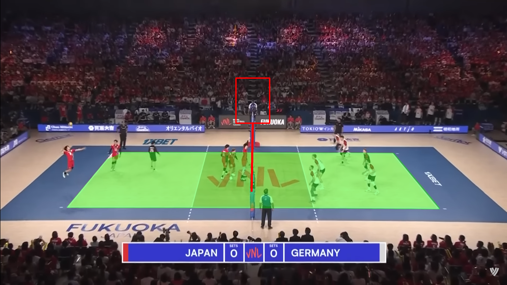

# VolleyMap

Locating the **court**, the **net** and the **referee area** in volleyball broadcast frames, using only classical image processing: no neural networks and no training data.

<p align="center"></p>

The goal is to isolate the referee area so that it can later be passed to a gesture-recognition model. Court and net detection also work on their own, for example for court analytics or player tracking.

## How it works

Detecting the referee directly (uniform colors, silhouettes) or the court lines directly proved unreliable. The most stable feature turned out to be the **color of the court**, so the pipeline finds the court first and uses it as a reference for everything else:

1. **Preprocessing**: double the saturation (HSV) to separate the colors better.
2. **Court**: K-means splits the image into 3 color clusters. Each cluster is cleaned with a horizontal blur, thresholding and morphological operations, then reduced to its largest connected component with the holes filled. The court is the component without large holes whose center is closest to the expected court position.
3. **Net**: in the court area, extended upwards, Canny edges and the Hough transform find near-vertical lines. The longest one is the net.
4. **Referee area**: a rectangle above the top of the net, sized in proportion to the net length.

The [notebook](volleymap.ipynb) explains every step and shows the intermediate images.

## Running it

```bash
pip install -r requirements.txt
```

Open `volleymap.ipynb` in Jupyter or VS Code and run all cells. To try another frame, change `IMAGE_PATH` in the *Constants* cell; sample frames are in [`data/`](data).

The parameters (number of clusters, kernel sizes, Hough thresholds, expected court position) are tuned on the sample frames and may need adjusting for other courts, lighting conditions or camera angles.

## Tech

Python · OpenCV · NumPy · Matplotlib · Jupyter

## Authors

Developed with [Nizar Nadif](https://github.com/NizarNadif).
